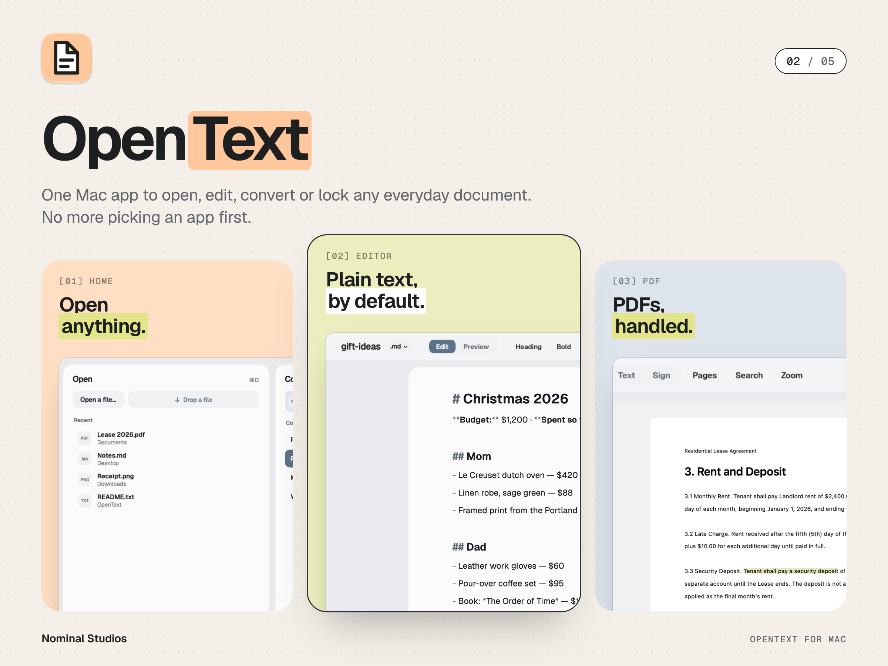

# OpenText

One Mac app to open, edit, convert or lock any everyday document, without picking an app first.



OpenText replaces the shuffle between TextEdit, Preview, Adobe Reader and online converters. Open a text file, PDF, photo or Word document, read it or make a quick edit, change its format, and save.

## What it does

- **Plain text by default.** `.txt` and `.md` open as plain text, never rich text. Flip Markdown to Preview with one click.
- **Change the format from the title bar.** Click the file's extension (`.md`, `.txt`, `.pdf`) and pick another format.
- **Convert in place.** PDF to text, Markdown, Word or images. Photos to PNG or JPEG. The new file is saved next to the original, which never changes. Scanned PDFs are read with on-device text recognition.
- **PDFs.** Page thumbnails, search, highlight, add text, sign, combine PDFs, and reorder or delete pages by dragging.
- **Images.** Crop, resize, rotate and flip, then save or convert.
- **Other documents.** Read `.docx`, `.rtf`, `.html` and similar files, and extract their text or convert them.
- **Lock any file.** AES-256 encryption with Touch ID and a one-time recovery key. The [file format](docs/build/otlock-format.md) is documented, so a locked file can be opened without the app.
- **New files from anywhere.** A global shortcut (⌃⌥N), the menu bar, or right-click in Finder.
- **For scripts and AI agents.** A command-line tool and an MCP server do the same conversions, text extraction and locking. See [CLI and MCP](docs/build/cli-mcp.md).

Everything runs on your Mac. Nothing is uploaded, and there are no accounts or paid services.

## Requirements

- macOS 26 or later
- Xcode 26 and [XcodeGen](https://github.com/yonaskolb/XcodeGen) to build

## Build

```bash
git clone https://github.com/walk-the-program/OpenText.git
cd OpenText
xcodegen generate
open OpenText.xcodeproj
```

Choose your own team under Signing & Capabilities for the `OpenText` and `OpenTextFinder` targets, then build and run the `OpenText` scheme. `scripts/install.sh` builds a signed Release and installs it to `/Applications`. It uses the maintainer's team ID, so change `DEVELOPMENT_TEAM` there first.

The command-line tool and MCP server build on their own:

```bash
cd Packages/OpenTextKit && swift build -c release
```

## Project layout

| Path | What's there |
|---|---|
| `App/` | The Mac app: windows, menus, routing and services |
| `FinderExtension/` | Finder right-click menu |
| `Packages/OpenTextKit` | Conversion, text extraction and locking, plus the `opentext` CLI and `opentext-mcp` server |
| `Packages/OpenTextUI` | Editor, PDF reader, image editor, Home and sheets |
| `Packages/OpenTextDesign` | Colors, type and the brand mark |
| `docs/` | Product notes, build docs and reviews |

## License

MIT, see [LICENSE](LICENSE). The bundled Geist and Geist Mono fonts are under the SIL Open Font License (`Packages/OpenTextDesign/Sources/OpenTextDesign/Fonts/`).

Made by Nominal Studios.
